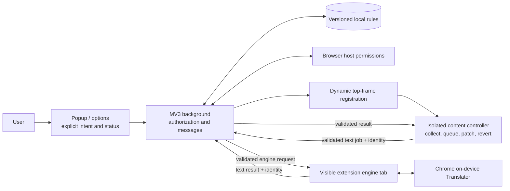

# Architecture

Revision: 2026-10-25. This document describes the Phase 0–1 boundary design; evidence and remaining gaps are in [TEST_PLAN.md](TEST_PLAN.md).

## Ownership and trust boundaries

WXT produces separate Chrome and Firefox MV3 artifacts from strict TypeScript. The popup/options use native DOM and small local styles; React/Tailwind add no necessary capability to this slice. Page translation never uses a UI framework or replaces framework-owned markup.

The background owns the rule repository, privileged permissions, dynamic registration and message routing. It has no webpage DOM. Its listeners are registered synchronously; durable intent is stored immediately, and startup/permission events reconcile registrations. Chrome's worker may terminate, so globals never constitute the source of truth. Firefox uses an event-page background generated by WXT. These runtime models are checked in build artifacts. See [Chrome worker lifecycle](https://developer.chrome.com/docs/extensions/develop/concepts/service-workers/lifecycle) and [Mozilla background configuration](https://developer.mozilla.org/en-US/docs/Mozilla/Add-ons/WebExtensions/manifest.json/background).

Content owns only its living document: bounded eligible-text collection, pending work, original-value reconciliation and progress. Page DOM is untrusted. Message sender identity, frame, current URL and request limits are checked before privileged work; the webpage cannot select arbitrary destination tabs or providers. Results are plain strings assigned to exact Text nodes. There is no `window.postMessage` bridge or MAIN-world history patch.

The engine adapter accepts typed jobs independently of DOM collection. The native implementation lives in a user-visible extension document because Translator is unavailable in workers. Explicit setup provides user activation, creates the pair and reports model progress. The tab remains open across webpage navigations; it is not a mechanism for keeping the background worker alive. The browser can still discard it, and the next job must surface unavailable/setup state. [Chrome Translator documentation](https://developer.chrome.com/docs/ai/translator-api) documents `availability`, `create`, user activation, model progress and the worker restriction.

## Persistence sequence

1. Popup obtains the active tab context and explicit selected pair.
2. A user action requests a host grant; background verifies the resulting permission before saving an enabled exact-origin rule.
3. Background registers the isolated script for the granted host and injects the current eligible document. Registration is reconciled on service startup and permission changes.
4. Content bootstrap asks for effective intent. Background validates the sender's exact origin and current authorization before returning it.
5. Content collects a bounded batch, sends its identity and source strings, then applies only matching valid results to unchanged connected nodes.
6. Full navigation destroys that document state. The newly registered content instance independently repeats steps 4–5 for `/login`.

Browser match patterns and grants are transport authorization, while the rule key is exact scheme/host/port. A broad browser match must never authorize a second origin's translation. Even if a script is injected on another port under the same host grant, it receives no matching rule and cannot submit an authorized job. This distinction also prevents subdomain and scheme confusion. See [Chrome match patterns](https://developer.chrome.com/docs/extensions/develop/concepts/match-patterns).

## Cancellation, reconciliation and failure

Jobs carry request/document IDs and document/route epochs. Content invalidates pending work when the active rule, target or lifecycle changes. Abort is best effort; identity, provider, language, node connection and original-value checks remain mandatory after every await. A WeakMap records original and extension-applied text. Restore skips site-authored changes. Known unchanged translations are not recursively collected as source.

Mutation processing is bounded and incremental; Phase 1 safety support is not a claim that every framework, route or 10,000-node page has been verified. Missing source-language hints require explicit selection. Attributes, closed/open Shadow DOM, inaccessible frames, BFCache and comprehensive SPA behavior remain recorded follow-up work.

Network translation has no implementation in this phase. Page text exists only in content/job/engine memory and native inference; rules contain no text. A future engine can fit the same job interface, but must add independent consent, endpoint validation, privacy and provider tests before use. Firefox returns an honest unavailable state rather than calling Chrome's API or substituting a fake.

## Build and delivery boundary

CI installs the lockfile, runs static/unit/browser checks, builds both manifests, lints Firefox, verifies permission/package allowlists, scans secrets and audits dependencies. Release automation packages unsigned Chrome/Firefox ZIPs plus source and checksums into a draft release. Store accounts, signing credentials and publication are outside those jobs. Decisions and legal/provider dependencies are tracked in [DECISIONS.md](DECISIONS.md).
